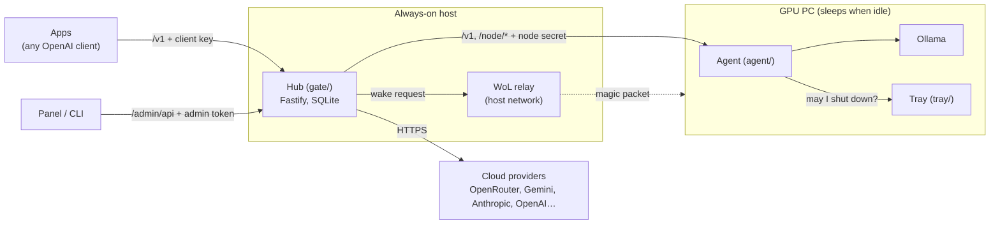

# MindGate

[](https://github.com/prod-explore/mindgate/actions/workflows/ci.yml)

MindGate is a self-hosted gateway that gives your apps one OpenAI-compatible endpoint for cloud models and for the models on your own GPU PC. It wakes that PC with Wake-on-LAN when a request needs it, and asks it to shut down again when it has been idle.

The hub runs on a small always-on machine (a Raspberry Pi or any Linux host with Docker). Every app gets its own key with rate limits, token budgets, a priority and, if needed, a local-only flag that the hub enforces before a request can leave your network. Prompts and answers are never stored.

**Status:** in daily use: the hub runs on a Raspberry Pi 5, the local node on my desktop PC. I built it to reach the models on that PC remotely through an API, and grew it into a hub for local and cloud providers.

<p>
  
  
</p>

*The admin panel, filled with demo data by [`tools/screenshots.mjs`](tools/screenshots.mjs): the real hub, agent and panel, with stand-ins for Ollama and the cloud providers. More screens in [docs/09](docs/09-panel.md#screenshots).*

## What it does

- **One API for many providers.** `POST /v1/chat/completions` (streaming, tools, images), `POST /v1/embeddings` and `GET /v1/models`, in the OpenAI format. Behind it: any OpenAI-compatible server (OpenRouter, OpenAI, Gemini's compatibility endpoint, Ollama, LM Studio, vLLM, llama.cpp) and Anthropic's Messages API, translated both ways.
- **A GPU PC that sleeps.** A request for one of its models wakes it (if the request's priority is high enough), waits for it to boot, then queues by priority for a free slot. After a set idle time the hub asks the PC to shut down; the PC refuses while it is working or while someone is using it.
- **Models on the PC are managed from the hub.** Download (including GGUF models from Hugging Face), delete, load into GPU memory, unload, and see CPU, RAM, GPU and disk, through the agent that runs next to Ollama.
- **A key per app.** Requests per minute and per day, tokens per day and per month (in your time zone), a priority range, an allow-list of models, and `local_only`.
- **No silent substitution.** A request is served by the model it names, `provider/model`, or it fails. Failures that another model could fix carry `"fallback": true`, so the app can choose what to try next.
- **An admin panel and a CLI.** Providers, models, keys, usage, a request log without content, and the machines; key management, backups and a configuration check from the command line.

## Quick start

You need Docker with Compose, `openssl`, `curl`, `jq`, and an API key for one cloud provider (the example uses OpenRouter). To add your own GPU PC, see [the next section](#add-your-gpu-machine).

**1. Start the hub.**

```bash
git clone https://github.com/prod-explore/mindgate.git
cd mindgate/gate

# two different random secrets; the hub refuses to start with placeholders or weak values
printf 'MINDGATE_MASTER_KEY=%s\nMINDGATE_ADMIN_TOKEN=%s\n' "$(openssl rand -hex 32)" "$(openssl rand -hex 32)" > .env

docker network create mindgate_net     # docker-compose.yml expects it (a reverse proxy joins it)
docker compose -f docker-compose.yml -f docker-compose.local.yml up -d --build
curl http://127.0.0.1:3000/health      # {"status":"ok"}
```

`docker-compose.local.yml` publishes the port on `127.0.0.1` only. Behind nginx or Caddy you leave it out: see [docs/01](docs/01-gate.md#reverse-proxy-nginx).

The panel is at <http://127.0.0.1:3000/admin/>. Sign in with the admin token: `sed -n 's/^MINDGATE_ADMIN_TOKEN=//p' .env`.

**2. Add a provider, switch on a model, create a key.** In the panel: *Providers → OpenRouter*, then *Models*, then *Client keys*. Or from the shell, in the same directory:

```bash
HUB=http://127.0.0.1:3000
ADMIN="Authorization: Bearer $(sed -n 's/^MINDGATE_ADMIN_TOKEN=//p' .env)"

# the hub fetches the provider's model list at once; OpenRouter's models start switched off
curl -s -X POST $HUB/admin/api/providers -H "$ADMIN" -H 'Content-Type: application/json' -d '{
  "id": "openrouter", "type": "openai", "base_url": "https://openrouter.ai/api/v1",
  "api_key": "<your OpenRouter key>", "locality": "cloud", "options": { "auto_enable_models": false }
}'

# list the model ids, pick one and switch it on
curl -s "$HUB/admin/api/models?provider=openrouter" -H "$ADMIN" | jq -r '.data[].id'
MODEL=<one of the ids above>
curl -s -X PATCH "$HUB/admin/api/models/$MODEL" -H "$ADMIN" -H 'Content-Type: application/json' -d '{"enabled": true}'

# a key for one client: the full key is printed once and only its hash is stored
docker compose exec gate node dist/cli.js keys create laptop --rpm 30
```

**3. Send a request.**

```bash
KEY=<the mg-... key printed above>
curl -s $HUB/v1/chat/completions -H "Authorization: Bearer $KEY" -H 'Content-Type: application/json' \
  -d '{"model": "'"$MODEL"'", "messages": [{"role": "user", "content": "Say hi"}]}'
```

The answer is an OpenAI chat completion plus a `mindgate` object that names the model and provider that answered. Any OpenAI SDK works with base URL `http://127.0.0.1:3000/v1`, the key and a model id: [docs/07](docs/07-clients.md).

<details>
<summary>Without Docker (Node.js 22.19 or newer)</summary>

```bash
cd mindgate
(cd panel && npm ci && npm run build)      # the panel; the hub serves panel/dist at /admin/
cd gate && npm ci && npm run build
printf 'MINDGATE_MASTER_KEY=%s\nMINDGATE_ADMIN_TOKEN=%s\n' "$(openssl rand -hex 32)" "$(openssl rand -hex 32)" > .env
npm start                                  # reads gate/.env; the database goes to gate/data/
```

The hub listens on all interfaces (`MINDGATE_HOST=127.0.0.1` keeps it on this machine). Steps 2 and 3 are the same, with `npm run cli -- keys create laptop --rpm 30` in `gate/` instead of `docker compose exec`.
</details>

### Deploying

CI publishes the hub image for amd64 and arm64 to `ghcr.io/prod-explore/mindgate-hub` ([image.yml](.github/workflows/image.yml)). [`scripts/deploy.sh`](scripts/deploy.sh) pulls a tag, waits for the container's health check, and goes back to the previous image when the new one does not become healthy. The package is public, so it pulls without logging in.

Runs on a Raspberry Pi 5 (8 GB) for the hub and a desktop PC as the local node.

Reverse proxy, backups, environment variables and troubleshooting: [docs/01](docs/01-gate.md).

## Add your GPU machine

The PC runs two small programs next to [Ollama](https://ollama.com): the **agent** (`agent/`), which the hub talks to, and on a desktop the **tray** app (`tray/`), which tells the agent whether someone is using the computer.

1. **The agent** (Windows or Linux, Node.js 22.19 or newer, Ollama installed):

   ```bash
   cd mindgate/agent
   npm ci && npm run build
   printf 'MINDGATE_NODE_SECRET=%s\n' "$(openssl rand -hex 32)" > .env
   npm start    # as a service: npm run install-service (Windows) or mindgate-agent.service (systemd)
   ```

   It adopts a running Ollama or starts one, and puts it behind the secret. Details: [docs/02](docs/02-agent.md).

2. **Wake-on-LAN** in the BIOS and the network driver, and, when the hub runs in Docker, the small relay container that sends the packet from the host's network (`COMPOSE_PROFILES=wol`): [docs/06](docs/06-wol.md).

3. **Register the machine** as a provider (the panel has a preset for it):

   ```bash
   curl -s -X POST $HUB/admin/api/providers -H "$ADMIN" -H 'Content-Type: application/json' -d '{
     "id": "pc", "name": "My PC", "type": "openai",
     "base_url": "http://192.168.1.100:3001/v1", "api_key": "<MINDGATE_NODE_SECRET from agent/.env>",
     "locality": "local", "max_concurrency": 1,
     "node": { "mac": "AA:BB:CC:DD:EE:FF", "broadcast": "192.168.1.255",
               "control_url": "http://192.168.1.100:3001", "idle_shutdown_minutes": 15 }
   }'
   ```

   Its models then appear as `pc/<ollama name>`, for example `pc/qwen3:4b`. Download new ones from the panel or with `POST /admin/api/providers/pc/node/pulls` ([docs/04](docs/04-models.md)).

4. **The tray** on a Windows desktop (Linux on a best-effort basis): [docs/03](docs/03-tray.md). Without it, set `MINDGATE_TRAY_URL=` (empty) in `agent/.env`; otherwise the agent refuses every idle shutdown, because it cannot rule out that someone is at the computer.

## How it works



A request to `/v1/chat/completions` goes through these steps ([`gate/src/chat.ts`](gate/src/chat.ts)):

1. **Key.** The bearer key is hashed and looked up; repeated failures from one address are throttled.
2. **Model.** `provider/model` must exist, be allowed for the key, be the right kind (chat or embedding) and, for a local-only request, run locally. Otherwise the request is refused before anything is sent.
3. **Limits.** Requests per minute and per day, tokens per day and per month.
4. **Machine.** If the provider is a PC that sleeps, the hub probes it, wakes it (one wake-up for all waiting requests) and waits up to `boot_timeout_ms`. A request below the PC's `min_wake_priority` gets `503 node_asleep` at once instead.
5. **Slot.** A provider with `max_concurrency` (one GPU) has a queue ordered by priority, 5 first.
6. **Answer.** The upstream's answer is relayed; a stream is passed on chunk by chunk, with SSE comments while a cold model loads so that proxies keep the connection open.
7. **Record.** Who, which model, status, timings and token counts go to the request log and the daily totals. The text does not.

### Decisions and their trade-offs

**The hub never answers with a model the client did not ask for.** There are no aliases and no hub-side fallback chains. A silent switch would change behaviour behind the app's back, and could move a private request to a provider the app did not choose. Instead, every failure that another model could fix carries a flag:

```json
{"error":{"message":"Provider \"openrouter\" is not reachable (ECONNREFUSED)","type":"server_error","code":"upstream_unreachable","provider":"openrouter","fallback":true}}
```

Errors in the request itself (a context that is too long, a model the key may not use) never carry it. The cost: each app implements its own retry, typically by picking another model by the `tags` that `GET /v1/models` shows.

**Waking the PC depends on priority.** Requests with priority 3 or more (the default `min_wake_priority`) may wake it. Lower-priority ones, such as background jobs, get `node_asleep` with `fallback: true` straight away, so they can use a cloud model instead of booting the PC. The cost: the first request after a sleep waits for the boot (up to two minutes by default).

**The PC decides whether it shuts down.** The hub only asks. The agent refuses while a request or a download is running, and asks the tray, which refuses while someone has used the keyboard or mouse recently or has ticked "Don't shut down this computer". A tray that does not answer counts as a "no". After a refusal the hub waits five minutes before it asks again. The cost: the PC may stay on longer than its idle time.

**An agent in front of Ollama instead of Ollama on the network.** Ollama has no authentication. The agent adds a secret, model management, the hardware status and the shutdown guard. It stops generation when the hub disconnects, and it reports the context length Ollama is really configured for (`OLLAMA_CONTEXT_LENGTH`), not the model's theoretical maximum. The cost: one more service on the PC. Any OpenAI-compatible server still works as a plain provider without it.

**One process, SQLite, state in memory.** Providers, models, keys and usage are in one SQLite file. The queues, the per-minute window and the machines' state are in the process. Nothing else has to run next to it. The cost: one hub instance, and a restart forgets the per-minute window and drops queued requests.

**Numbers, not text.** The request log has who, what, how long and how many tokens; it never contains a prompt or an answer, and it is pruned after 30 days by default.

### Security model

What is protected, and how ([SECURITY.md](SECURITY.md) has the reporting process and the scope):

- **Provider API keys** are encrypted at rest with AES-256-GCM. The key comes from `MINDGATE_MASTER_KEY` through HKDF with a random salt per value, and the provider id is bound in as associated data, so a ciphertext copied to another row does not decrypt. The master key lives in the environment, not in the database: a stolen database or backup alone does not reveal the keys. Someone with root on the host does get them. Stored keys never come back from the API; only the last four characters do.
- **Client keys** are generated at random (`mg-` and 32 random bytes) and stored only as SHA-256 hashes.
- **The admin API and the panel** need a separate admin token. Twenty failed authentications (client key or admin token) from one address within a minute block that address for up to a minute; behind a proxy this needs `MINDGATE_TRUST_PROXY=true`, and the hub warns when it is missing. The panel is served with a strict Content-Security-Policy and loads nothing from other origins.
- **Weak secrets are refused at start**: placeholders, values under 24 characters and values with too few distinct characters, for the hub and the agent alike.
- **Local-only** is checked on the hub for every request, from the key or from the `X-MindGate-Local-Only` header. A model is local when its provider is marked local; a provider can report one of its models as cloud, but only the owner can mark a model local.
- **The agent** answers nothing, `/health` included, without the node secret (compared in constant time), and does not pass the secret on to Ollama.
- **The container** runs as an unprivileged user with a read-only root filesystem, all capabilities dropped and `no-new-privileges`; its port is not published unless you add `docker-compose.local.yml`.
- **The Wake-on-LAN relay** needs a shared token and sends packets only to the broadcast addresses of the host's own networks.

What is not protected: traffic between the hub and the agent is plain HTTP, so it belongs on a trusted LAN or inside a VPN such as WireGuard or Tailscale. The hub does not terminate TLS; put a reverse proxy in front of it. There is one admin token and no user accounts.

## Known limits

- **One hub instance.** Queues, per-minute limits and machine state are held in memory (see above).
- **Budgets are checked before a request.** Requests already running can take a key slightly past its token budget; the next one is refused. When a provider reports no token usage, the hub estimates it at about four characters per token and marks the numbers as estimated.
- **Endpoints:** chat completions, embeddings, models and usage. No `/v1/responses`, images or audio.
- **Provider protocols:** OpenAI-compatible and Anthropic Messages. With Anthropic, `n > 1` is refused and parameters without an equivalent are ignored.
- **A stream that breaks midway** ends with an error event. Nothing resumes it, and the error has no `fallback` flag once content has been sent.
- **The agent drives Ollama only.** Other engines would implement the `Runtime` interface in [`agent/src/runtime.ts`](agent/src/runtime.ts). GPU figures come from `nvidia-smi`, so other GPUs show none.
- **Wake-on-LAN works within one LAN.** The relay sends only to its own networks' broadcast addresses.
- **The tray targets Windows.** On Linux the icon and the idle check work but the shutdown block does not. The agent's documentation covers Windows and Linux.
- **The panel is in English only.**

## Repository layout

| Path | What | Built with |
|---|---|---|
| [`gate/`](gate/) | The hub: client API, admin API, routing, limits, queues, Wake-on-LAN, the CLI and the Docker setup | TypeScript, Fastify, better-sqlite3, undici |
| [`panel/`](panel/) | The admin panel, served by the hub at `/admin/` | React, Vite, TypeScript |
| [`agent/`](agent/) | The service on the GPU PC: proxy to Ollama, model management, power | TypeScript, Fastify |
| [`tray/`](tray/) | The tray app on the PC: status icon, "someone is here", shutdown guard | JavaScript, systray2, small C# helpers on Windows |
| [`e2e/`](e2e/) | The real hub, the real agent and an Ollama stand-in, end to end | `node:test` |
| [`scripts/`](scripts/) | `deploy.sh` with rollback; Windows helpers (restart the agent and the tray, start the hub without a console) | Bash, batch, VBScript |
| [`tools/`](tools/) | Regenerates the screenshots from the real code and demo data | Playwright |
| [`docs/`](docs/) | Reference documentation, listed below | |

## Development

Each component has its own `package.json` and lockfile; its `engines` field names the Node.js 22 release it needs.

```bash
npm ci && npm run lint                            # ESLint over every component, from the root
(cd gate  && npm ci && npm test)                  # compile, then node:test
(cd panel && npm ci && npm run build && npm test) # type check and build, then Vitest + Testing Library
(cd agent && npm ci && npm test)
(cd tray  && npm ci && npm test)
node --test --test-timeout=60000 e2e/*.test.mjs   # after gate and agent are built
```

For panel work, run `npm run dev` in `gate/` and in `panel/`: Vite serves the panel at <http://localhost:5173/admin/> and forwards `/admin/api` to the hub ([docs/09](docs/09-panel.md#developing-the-panel)).

CI ([`.github/workflows`](.github/workflows)) runs on every push and pull request: the lint, each component's tests, the end-to-end chain, a Docker build that must start and serve `/health` and the panel, and `npm audit` on production dependencies. CodeQL and a gitleaks scan of the full history run too; Dependabot proposes minor and patch updates weekly.

## Documentation

| | |
|---|---|
| [01 Hub](docs/01-gate.md) | Installation, the request path, keys and limits, backups, reverse proxy, environment variables |
| [02 Agent](docs/02-agent.md) | The service on the GPU PC: installation, configuration, running it as a service, security |
| [03 Tray](docs/03-tray.md) | The tray app and the shutdown guard |
| [04 Models](docs/04-models.md) | Managing Ollama models from the hub, what fits in GPU memory, uncensored models |
| [05 Node protocol](docs/05-nodes.md) | The agent's API, for writing another agent |
| [06 Wake-on-LAN](docs/06-wol.md) | BIOS, network card, router, and the relay for a hub in Docker |
| [07 Clients](docs/07-clients.md) | Open WebUI, Continue, Cursor, Python, Node.js |
| [08 API](docs/08-api.md) | Every endpoint and error code |
| [09 Panel](docs/09-panel.md) | The admin panel and its security |

## License

[MIT](LICENSE), © 2026 Futumore (prod-explore).
