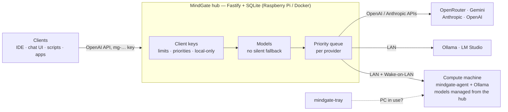
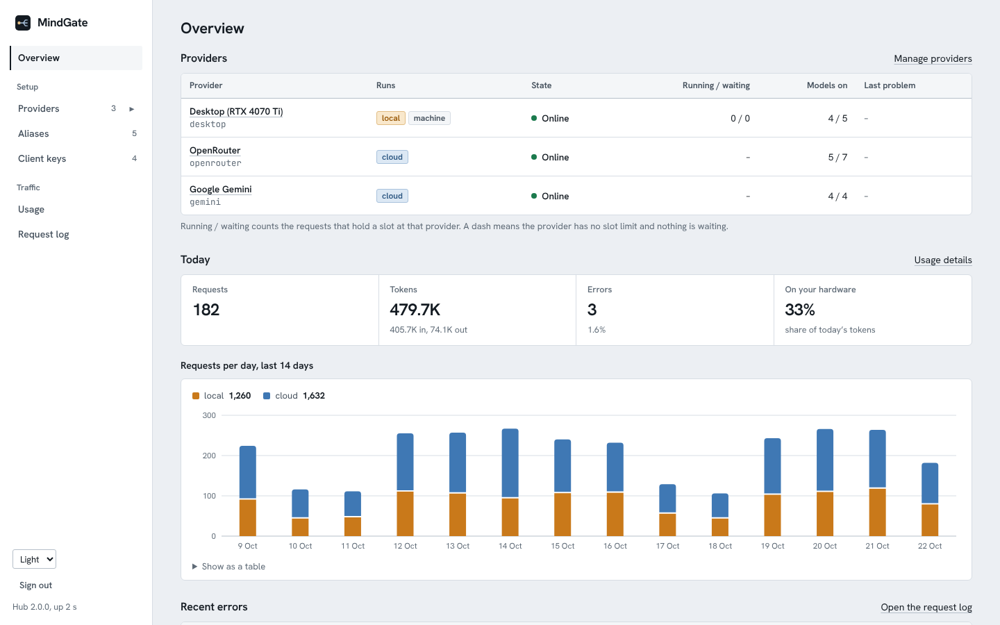
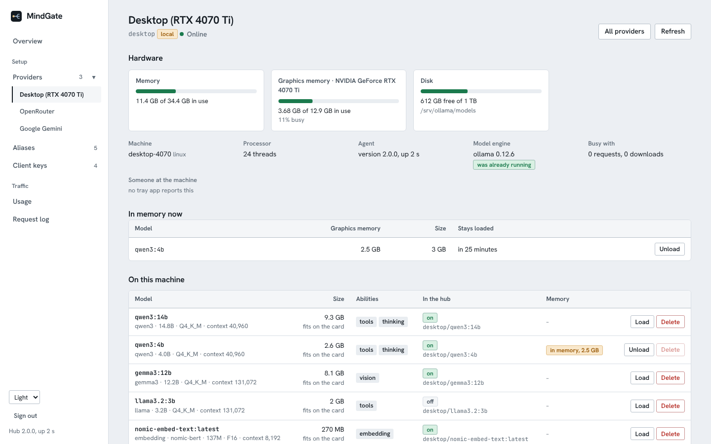
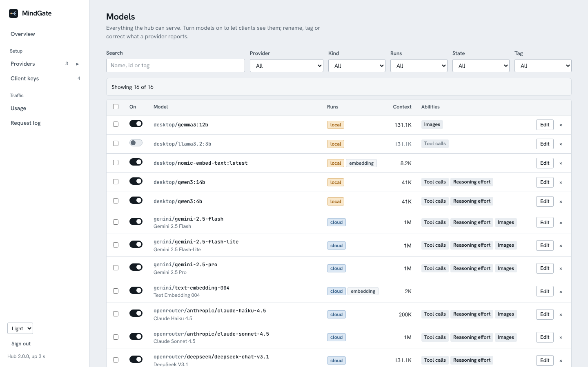
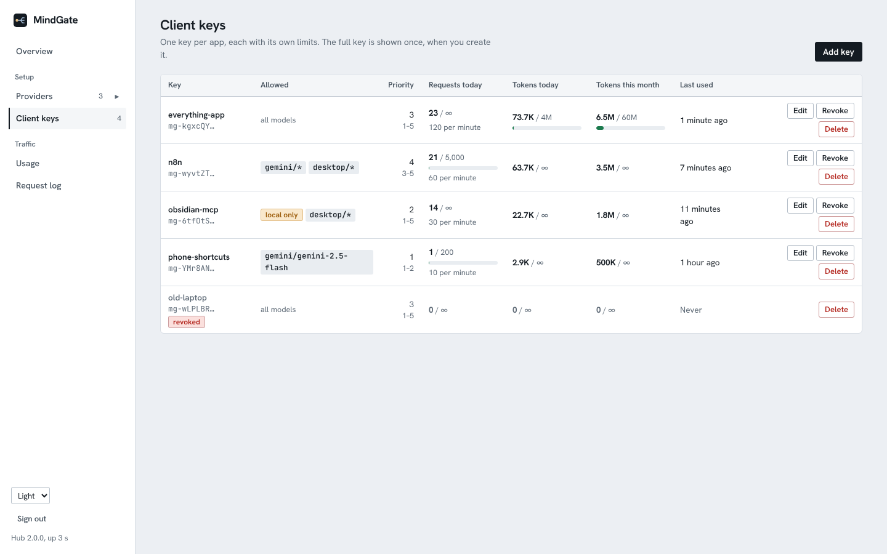
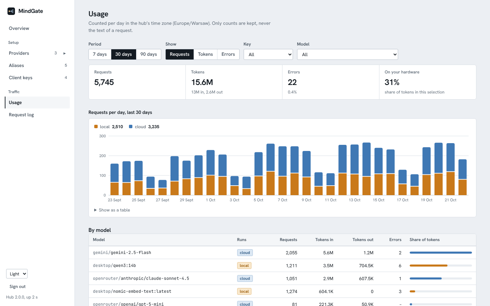
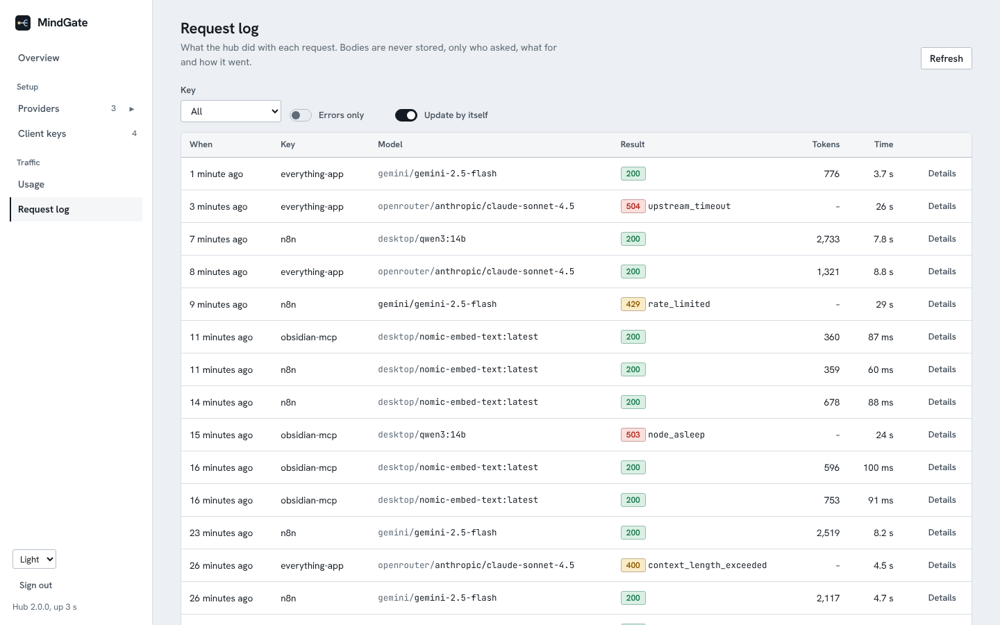

<div align="center">
  <h1>MindGate</h1>
  <p><strong>One OpenAI-compatible API in front of your own GPU machine and every cloud model you use</strong></p>

  [](https://github.com/prod-explore/mindgate/actions)
  [](https://nodejs.org/)
  [](https://opensource.org/licenses/MIT)
</div>

MindGate is a self-hosted **hub** (TypeScript, Fastify, SQLite; small enough for a Raspberry Pi): your IDE, chat UI, scripts and apps talk to one OpenAI-compatible endpoint with one key, and the hub sends each request to a local model on a PC that sleeps until it is needed, or to OpenRouter, Gemini, Anthropic, an Ollama on the LAN — anything that speaks HTTP. It gives you three things a plain proxy does not:

- **Control over where data goes.** A key (or a single request) can be *local-only*: nothing is sent to the cloud, fallbacks included.
- **No surprises in routing.** A model is never replaced by another one behind your back: the response says which one answered, and when it fails the error says whether the app may try another (`fallback: true`).
- **A GPU that costs nothing while idle.** The compute machine is woken with Wake-on-LAN when a request needs it and asked to shut down when it has been idle.

Try it with Docker; the admin panel is then at `http://localhost:3000/admin/` ([next steps](#getting-started)):

```bash
git clone https://github.com/prod-explore/mindgate.git && cd mindgate/gate
printf 'MINDGATE_MASTER_KEY=%s\nMINDGATE_ADMIN_TOKEN=%s\n' "$(openssl rand -hex 32)" "$(openssl rand -hex 32)" > .env
docker network create mindgate_net
docker compose -f docker-compose.yml -f docker-compose.local.yml up -d
```

The image comes from the GitHub Container Registry (amd64 and arm64, built by CI on every push to `main`), so this takes seconds; add `--build` to build it from your checkout instead.



---

## The admin panel

<picture>
  <source media="(prefers-color-scheme: dark)" srcset="docs/img/overview-dark.png">
  
</picture>

<table>
  <tr>
    <td width="50%"><br><b>A machine with a GPU</b> — its hardware, what sits in VRAM, and every installed model. Load, unload, download or delete from here.</td>
  </tr>
  <tr>
    <td><br><b>Models</b> — everything the hub can serve, synced from the providers, switchable one by one.</td>
    <td><br><b>Client keys</b> — one per app, with its own limits, allowed models and priority range.</td>
  </tr>
  <tr>
    <td><br><b>Usage</b> — requests, tokens and errors per day, key and model. Counts only, never text.</td>
    <td><br><b>Request log</b> — who asked for what, which model answered, how long it took, how it ended.</td>
  </tr>
</table>

<sub>Demo data: the pictures come from the real hub, agent and panel with a stand-in for the model runtime, generated by <code>tools/screenshots.mjs</code>.</sub>

---

## Features

- **OpenAI-compatible API** — chat completions (streaming, tools, images, JSON mode), embeddings, `/v1/models`. Works with Cursor, Continue, Open WebUI and any OpenAI SDK by changing the base URL.
- **Providers** — OpenAI-compatible servers (passed through untouched) and the native **Anthropic Messages API** (translated both ways: tools, images, extended thinking with signatures, cache usage, streaming).
- **Models** — canonical ids `provider/model`; model lists are synced from the providers, with owner overrides for names, tags (`free`, `coder`, `vision`… — apps choose a fallback by them), context length and locality.
- **Local-only mode** — on a key or per request (`X-MindGate-Local-Only`); cloud targets are skipped without being contacted, and the model list shows only what such a caller can reach.
- **Client keys** — stored as hashes, shown once; per key: requests per minute/day, token budgets per day/month (reset at local midnight in your time zone), allowed models, priority range. `GET /v1/usage` tells a client where it stands. Limits answer `429` with distinct codes (`rate_limited` vs `budget_exhausted`).
- **Priority queue** — 5 → 1, first come first served within a level, for providers that can do only one thing at a time (one GPU). Clients that disconnect leave the line.
- **Wake-on-LAN and idle shutdown** — low-priority requests do not wake the machine (they fail fast with `node_asleep`, so the app can ask another model); the connection is kept alive with SSE comments while it boots; a machine that vanishes mid-request is noticed and woken again. In Docker a small relay container on the host's network sends the broadcast (a bridge cannot).
- **Models on your own machines, managed from the hub** — the agent on a GPU machine exposes a small authenticated API: list what is installed (size, quantisation, capabilities, what sits in VRAM), download models (including `hf.co/…` GGUF repositories, with progress), delete, load and unload them, read CPU/RAM/GPU/disk, shut the machine down. Finished downloads appear in the hub's catalog by themselves; uncensored/abliterated models are tagged and stay local. No model list lives in a config file on the node.
- **Tray app on the GPU machine** (`/tray`, Windows; Linux best-effort) — shows what the agent is doing, notices that someone is using the PC, and has the final say before the agent powers it off; it also holds a manual Windows shutdown back while a request or a download is running.
- **Admin panel** — a web UI served by the hub at `/admin/` (React, no CDN or external requests, strict content security policy): providers, models, client keys, usage charts, the request log, and the models on each machine — download, load, unload, delete, shut down — with the hub never waking a machine just to look at it. Light and dark.
- **Private by construction** — the request log holds who, which model, how long, how many tokens, what failed. Never prompts or answers. Provider keys are encrypted at rest (AES-256-GCM, key from the environment); admin and client credentials are separate; failed logins are throttled.
- **Operations** — one SQLite file, `backup` and `check` commands, a hardened Docker setup (read-only root filesystem, no capabilities, an unprivileged user), 530+ tests as node:test and Vitest count them (hub 220+, panel 200+, agent 80+, end-to-end 10, tray 7): the hub against fake upstreams, the agent against a fake Ollama, the panel's screens, and a hub-to-agent end-to-end chain. CI builds and tests every package, builds the Docker image and checks that it serves `/health` and the panel, and runs `npm audit`, CodeQL and a gitleaks secret scan; Dependabot keeps the dependencies current.

---

## Key decisions

- **Why no automatic fallback between models?** A silent substitution changes quality, cost and — worst — *where your data goes*. Fallback is therefore the calling app's decision: the hub only says whether it is sensible (`fallback: true` in the error — provider failures only, never bad requests, never after the first byte of an answer reached the client).
- **Why does local-only filter fallbacks too?** The guarantee has to hold for the whole path, or it is not a guarantee. A cloud target is not skipped *after* an attempt — it is never attempted.
- **Why SQLite and not a config file?** Providers, models and keys change while the hub runs (and are edited from the admin panel). A single file with versioned migrations is easy to back up and needs no extra service on a Raspberry Pi.
- **Why a hub and a separate agent?** The always-on part (a Pi) must be cheap and small; the GPU machine should be off most of the time. The hub is the first, the agent and tray the second. The agent runs next to Ollama and does what only the machine can: start the runtime, report its hardware and models, download and delete models, and decide whether it is safe to power the PC off. It does no routing and holds no model list of its own — the hub is the one place where models, names and keys are managed.
- **Why priorities instead of a FIFO queue?** An IDE autocomplete must not wait behind a script summarising fifty documents, and a script should not wake the GPU at 3 a.m.

---

## Getting started

After the four commands at the top the hub runs in Docker, listening on `127.0.0.1:3000` only (`docker-compose.local.yml` publishes the port; behind nginx or Caddy you leave that file out, see [01 Hub](docs/01-gate.md)). `.env.example` lists every other setting. Still in `gate/`:

```bash
MINDGATE_ADMIN_TOKEN=$(grep '^MINDGATE_ADMIN_TOKEN=' .env | cut -d= -f2-)

# a provider (the admin API; see docs/08-api.md) …
curl -X POST http://localhost:3000/admin/api/providers \
  -H "Authorization: Bearer $MINDGATE_ADMIN_TOKEN" -H 'Content-Type: application/json' \
  -d '{"id":"openrouter","type":"openai","base_url":"https://openrouter.ai/api/v1","api_key":"sk-or-…"}'

# … and a key for a client (shown once)
docker compose exec gate node dist/cli.js keys create laptop --rpm 30
```

Then open `http://localhost:3000/admin/` and sign in with `MINDGATE_ADMIN_TOKEN`: everything above can be done there too.

Without Docker: Node 22, `cd panel && npm ci && npm run build`, then `npm ci && npm run build && npm start` in `gate/` (it reads `gate/.env`).

Setup guides are in [`docs/`](docs):
[01 Hub](docs/01-gate.md) · [02 Agent](docs/02-agent.md) · [03 Tray](docs/03-tray.md) · [04 Ollama](docs/04-models.md) · [05 Nodes](docs/05-nodes.md) · [06 Wake-on-LAN](docs/06-wol.md) · [07 Clients](docs/07-clients.md) · [08 API](docs/08-api.md) · [09 Panel](docs/09-panel.md)

---

## API usage

```bash
curl http://localhost:3000/v1/chat/completions \
  -H "Authorization: Bearer mg-your-key" \
  -H "X-MindGate-Priority: 4" \
  -H "X-MindGate-Local-Only: true" \
  -H "Content-Type: application/json" \
  -d '{"model": "pc/qwen3:4b", "messages": [{"role": "user", "content": "Explain transformer attention."}]}'
```

`model` is always `provider/model` (`pc/qwen3:4b` on your own machine, `openrouter/deepseek/deepseek-chat` in the cloud); there are no aliases. The response carries `X-MindGate-Model` / `X-MindGate-Provider` — who actually answered.

| Header | Meaning |
|---|---|
| `X-MindGate-Priority: 1–5` | queue position and whether the sleeping machine is woken (clamped to the key's range) |
| `X-MindGate-Local-Only: true` | only models on your own hardware, fallbacks included |
| `X-MindGate-Tag: my-app` | label stored in the request log |

---

## Updating

CI publishes `ghcr.io/prod-explore/mindgate-hub` with two tags, `latest` and `sha-<commit>`. On the host:

```bash
scripts/deploy.sh               # pull latest, restart the hub, wait for it to be healthy
scripts/deploy.sh sha-1a2b3c4   # a specific build; the same command rolls back
```

If the new image does not become healthy within 90 seconds, the script puts the previous one back and exits with an error. Nothing is compiled on the host, and the data volume is not touched.

## Development

```bash
cd gate
npm ci
npm test            # builds and runs the contract tests against fake OpenAI/Anthropic upstreams
npm run dev         # rebuild on change, restart on change

cd ../agent && npm ci && npm test      # the node agent against a fake Ollama
cd ../panel && npm ci && npm test      # the admin panel (Vitest + Testing Library); npm run build type-checks it, npm run dev for development
cd ../tray && npm ci && npm test       # the tray's state logic
cd .. && node --test e2e/*.test.mjs    # hub + agent + fake Ollama, after building both packages
npm ci && npm run lint                 # ESLint over every component (one config at the repository root)
```

The tests start real servers (the hub and fake upstreams, including a "machine" that sleeps) and cover streaming, tool calls, error mapping, fallback rules, local-only, limits with a fake clock across daylight-saving changes, the queue, Wake-on-LAN, the admin API and secret handling. The agent's tests run a fake Ollama (and a fake binary to start) and cover the authenticated API, model pulls with progress and cancellation, the passthrough proxy and the shutdown guard; the end-to-end chain checks that hub, agent and tray agree on every path.

## Repository structure

- `/gate` — the hub (TypeScript, Fastify, SQLite): routing, keys, limits, queue, adapters, admin API, CLI
- `/panel` — the admin panel (Vite, React, TypeScript), built to static files that the hub serves under `/admin/`
- `/agent` — compute-machine service (TypeScript, Fastify): authenticated node API, Ollama runtime and model management, OpenAI passthrough, power guard
- `/e2e` — end-to-end tests: hub, agent and a fake Ollama together
- `/tray` — desktop tray app (JavaScript, `systray2`) for the compute machine: agent status in the tray, idle detection, the last word on shutdown
- `/docs` — setup guides
- `/scripts/windows` — helpers for a Windows compute machine (restart the agent and the tray after an update, start the hub without a window)
- `/tools` — `screenshots.mjs`, which regenerates the pictures above from a seeded stack

---
<div align="center">
  <i>Self-hosted AI infrastructure with the data staying where you put it.</i>
</div>
