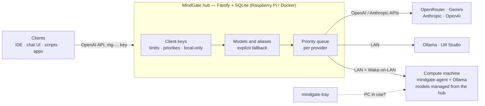

<div align="center">
  <h1>🧠 MindGate</h1>
  <p><strong>One OpenAI-compatible API in front of your own GPU machine and every cloud model you use</strong></p>

  [](https://github.com/prod-explore/mindgate/actions)
  [](https://nodejs.org/)
  [](https://opensource.org/licenses/MIT)
</div>

## Overview

MindGate is a self-hosted **hub**: clients (IDEs, chat UIs, scripts, your own apps) talk to one OpenAI-compatible endpoint with one key, and the hub decides where each request goes — a local model on a PC that sleeps until it is needed, OpenRouter, Gemini, Anthropic, an Ollama on the LAN, anything that speaks HTTP.

It exists for three things a plain proxy does not give you:

- **Control over where data goes.** A key (or a single request) can be *local-only*: nothing is sent to the cloud, fallbacks included.
- **No surprises in routing.** A model is only ever replaced by another one if *you* wrote that into an alias, and the response says which one answered.
- **A GPU that costs nothing while idle.** The compute machine is woken with Wake-on-LAN when a request needs it and asked to shut down when it has been idle.



---

## Features

- **OpenAI-compatible API** — chat completions (streaming, tools, images, JSON mode), embeddings, `/v1/models`. Works with Cursor, Continue, Open WebUI and any OpenAI SDK by changing the base URL.
- **Providers** — OpenAI-compatible servers (passed through untouched) and the native **Anthropic Messages API** (translated both ways: tools, images, extended thinking with signatures, cache usage, streaming).
- **Models and aliases** — canonical ids `provider/model`; model lists are synced from the providers, with owner overrides for names, tags, context length and locality. An alias is an ordered list of models and is the *only* place where fallback happens.
- **Local-only mode** — on a key or per request (`X-MindGate-Local-Only`); cloud targets are skipped without being contacted, and the model list shows only what such a caller can reach.
- **Client keys** — stored as hashes, shown once; per key: requests per minute/day, token budgets per day/month (reset at local midnight in your time zone), allowed models, priority range. `GET /v1/usage` tells a client where it stands. Limits answer `429` with distinct codes (`rate_limited` vs `budget_exhausted`).
- **Priority queue** — 5 → 1, first come first served within a level, for providers that can do only one thing at a time (one GPU). Clients that disconnect leave the line.
- **Wake-on-LAN and idle shutdown** — low-priority requests do not wake the machine (and fall back through an alias); the connection is kept alive with SSE comments while it boots; a machine that vanishes mid-request is noticed and woken again.
- **Models on your own machines, managed from the hub** — the agent on a GPU machine exposes a small authenticated API: list what is installed (size, quantisation, capabilities, what sits in VRAM), download models (including `hf.co/…` GGUF repositories, with progress), delete, load and unload them, read CPU/RAM/GPU/disk, shut the machine down. Finished downloads appear in the hub's catalog by themselves; uncensored/abliterated models are tagged and stay local. No model list lives in a config file on the node.
- **Private by construction** — the request log holds who, which model, how long, how many tokens, what failed. Never prompts or answers. Provider keys are encrypted at rest (AES-256-GCM, key from the environment); admin and client credentials are separate; failed logins are throttled.
- **Operations** — one SQLite file, `backup` and `check` commands, a one-shot `import-legacy` for the previous config format, Docker image, 280+ tests against fake upstreams, a fake Ollama and a hub-to-agent end-to-end chain.

---

## Key decisions

- **Why no automatic fallback between models?** A silent substitution changes quality, cost and — worst — *where your data goes*. Fallback is therefore explicit (an alias lists its targets in order), conservative (only for provider failures, never for bad requests, never after the first byte of an answer reached the client) and visible (`X-MindGate-Fallback`, `mindgate.attempts`).
- **Why does local-only filter fallbacks too?** The guarantee has to hold for the whole path, or it is not a guarantee. A cloud target is not skipped *after* an attempt — it is never attempted.
- **Why SQLite and not a config file?** Providers, models, aliases and keys change while the hub runs (and will be edited from a panel). A single file with versioned migrations is easy to back up and needs no extra service on a Raspberry Pi.
- **Why a hub and a separate agent?** The always-on part (a Pi) must be cheap and small; the GPU machine should be off most of the time. The hub is the first, the agent and tray the second. The agent runs next to Ollama and does what only the machine can: start the runtime, report its hardware and models, download and delete models, and decide whether it is safe to power the PC off. It does no routing and holds no model list of its own — the hub is the one place where models, names and keys are managed.
- **Why priorities instead of a FIFO queue?** An IDE autocomplete must not wait behind a script summarising fifty documents, and a script should not wake the GPU at 3 a.m.

---

## Getting started

```bash
git clone https://github.com/prod-explore/mindgate.git
cd mindgate/gate

cp .env.example .env            # put two different secrets in it:  openssl rand -hex 32
docker network create mindgate_net
docker compose up -d --build

# a provider (the admin API; see docs/08-api.md) …
curl -X POST http://localhost:3000/admin/api/providers \
  -H "Authorization: Bearer $MINDGATE_ADMIN_TOKEN" -H 'Content-Type: application/json' \
  -d '{"id":"openrouter","type":"openai","base_url":"https://openrouter.ai/api/v1","api_key":"sk-or-…"}'

# … and a key for a client (shown once)
docker compose exec gate node dist/cli.js keys create laptop --rpm 30
```

Without Docker: Node 22, `npm ci && npm run build && npm start` in `gate/`.

Coming from the previous gate? `node dist/cli.js import-legacy config.yml` moves the machine, Wake-on-LAN settings and client keys over; add `--agent-models` with the old agent's `models.yml` to keep the old profile names working as aliases. Pipelines and MCP tool injection are gone.

Setup guides (Polish) are in [`docs/`](docs):
[01 Hub](docs/01-gate.md) · [02 Agent](docs/02-agent.md) · [03 Tray](docs/03-tray.md) · [04 Ollama](docs/04-models.md) · [05 Nodes](docs/05-nodes.md) · [06 Wake-on-LAN](docs/06-wol.md) · [07 Clients](docs/07-clients.md) · [08 API](docs/08-api.md)

---

## API usage

```bash
curl http://localhost:3000/v1/chat/completions \
  -H "Authorization: Bearer mg-your-key" \
  -H "X-MindGate-Priority: 4" \
  -H "X-MindGate-Local-Only: true" \
  -H "Content-Type: application/json" \
  -d '{"model": "smart", "messages": [{"role": "user", "content": "Explain transformer attention."}]}'
```

`model` is an alias (`smart`) or a provider model (`openrouter/deepseek/deepseek-chat`). The response carries `X-MindGate-Model` / `X-MindGate-Provider` — who actually answered — and, if an alias had to move on, `X-MindGate-Fallback`.

| Header | Meaning |
|---|---|
| `X-MindGate-Priority: 1–5` | queue position and whether the sleeping machine is woken (clamped to the key's range) |
| `X-MindGate-Local-Only: true` | only models on your own hardware, fallbacks included |
| `X-MindGate-Tag: my-app` | label stored in the request log |

---

## Development

```bash
cd gate
npm ci
npm test            # builds and runs the contract tests against fake OpenAI/Anthropic upstreams
npm run dev         # rebuild on change, restart on change

cd ../agent && npm ci && npm test      # the node agent against a fake Ollama
cd .. && node --test e2e/*.test.mjs    # hub + agent + fake Ollama, after building both packages
```

The tests start real servers (the hub and fake upstreams, including a "machine" that sleeps) and cover streaming, tool calls, error mapping, fallback rules, local-only, limits with a fake clock across daylight-saving changes, the queue, Wake-on-LAN, the admin API and secret handling. The agent's tests run a fake Ollama (and a fake binary to start) and cover the authenticated API, model pulls with progress and cancellation, the passthrough proxy and the shutdown guard; the end-to-end chain checks that hub, agent and tray agree on every path.

## Repository structure

- `/gate` — the hub (TypeScript, Fastify, SQLite): routing, keys, limits, queue, adapters, admin API, CLI
- `/agent` — compute-machine service (TypeScript, Fastify): authenticated node API, Ollama runtime and model management, OpenAI passthrough, power guard
- `/e2e` — end-to-end tests: hub, agent and a fake Ollama together
- `/tray` — desktop tray app: idle detection and shutdown guard for the compute machine
- `/docs` — setup guides

---
<div align="center">
  <i>Self-hosted AI infrastructure with the data staying where you put it.</i>
</div>
